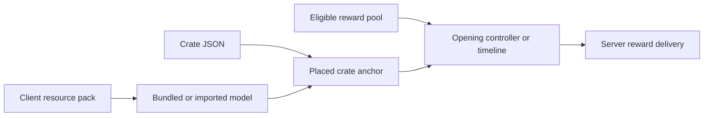

# Custom Content

UniCrates 2.3 separates the crate definition, its visual assets, and its opening. Combine a bundled model with your own rewards, import a Java item model, or build a custom timeline without recompiling the mod.

| Your goal | Start here |
| --- | --- |
| Make a crate using bundled content | [Create a crate](./create) |
| Edit crates in a browser and apply them to a server | [Web editor](./web-editor) |
| Choose a crate model and matching physical key | [Models and keys](./models) |
| Import your Blockbench model and PNG textures | [Model import](./model-import) |
| Generate and distribute client assets | [Resource packs](./resource-packs) |
| Write a complete definition by hand | [Crate JSON](./json) |
| Define prizes, eligibility, limits, and odds | [Rewards](./rewards) |
| Build an opening sequence | [Animations](./animations) |

## How the pieces fit



The model ID, crate ID, key ID, and animation ID have different jobs. A crate called `festival_crate` can use model `common`, key identity `festival_key`, and timeline `common_wooden_timeline`. Matching names are convenient, but are not required.

Use the [guided creation workflow](./create) for a working starting point, then change one layer at a time. A model preview confirms geometry and texture placement; the final opening and reward delivery still need an in-game check.

## Files you own

Paths are relative to the game or server directory:

```text
config/unicrates/
  main-config.json
  crates/festival_crate.json
  animations/festival_opening.json
  resources/models/festival_crate.json
  resources/models/keys/festival_crate.json
  resources/textures/custom/festival_crate/wood.png
```

`/crate reload` reads server definitions. `/crate exportpack` builds a ZIP for custom client assets. The [web editor](./web-editor) provides a separate save/apply workflow for a complete crate snapshot and staged model uploads.
