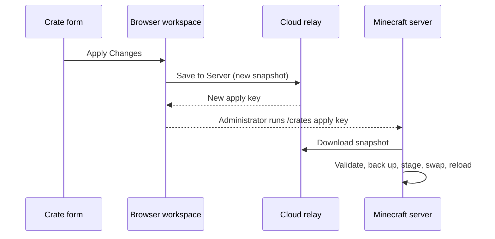

# Web Editor

The [UniCrates web editor](https://unicrates-cloud-relay.tausvokse.workers.dev/#/) edits crate definitions, custom timelines, and staged Java-model/PNG uploads. Start from a server-generated session to edit your server's actual content, or open the offline sandbox to design before applying.

## Open a server session

Run as an administrator:

```text
/crates editor
```

`/crate editor` is the same command. It uploads the loaded crates and custom animations, lists available built-in models/openings in session metadata, and sends a clickable link to the initiating command source. Editor access is controlled by the command's administrator permission check.

The default configuration is:

```json
{
  "webEditor": {
    "enabled": true,
    "editorUrl": "https://unicrates-cloud-relay.tausvokse.workers.dev/#/",
    "relayUrl": "https://unicrates-cloud-relay.tausvokse.workers.dev/"
  }
}
```

This is the `webEditor` section of `main-config.json`. Legacy placeholder and obsolete relay domains fall back to the current default in the code. You can configure your own compatible editor/relay. Browser builds also support a relay base through `VITE_RELAY_URL`; keep a custom browser build aligned with the server's relay configuration.

## Workspace and form controls

The workspace supports searching by crate ID, name, and model; creating from a template; editing; duplication; deletion; clearing the workspace; and JSON export. Duplication copies the definition, so review key identities and custom CMD values before saving a duplicate.

| Tab | Available workflow |
| --- | --- |
| **General & Key** | Crate ID/name/lore; physical, virtual, or hybrid keys; virtual balance ID; multi-key ALL/ANY requirements; currency/XP costs; cooldown, lifetime opening cap, permission and denied response; custom key JSON/PNG upload and preview |
| **3D Appearance** | Categorized built-in model cards; custom Java-model/PNG upload; orbitable model preview; scale; opening preset selection; scene particle density and sound volume for supported engine scenes |
| **Idle Animation** | Idle particle pattern/particle ID, density and movement controls; independent emitter height; model-and-emitter preview with play/pause |
| **Rewards & Odds** | Item, command, Pokémon, egg, economy, experience, permission, and key rewards; display icons; item name/lore/CMD; weighted odds; broadcasts; per-player/global limits, fallback reward, required/denied permissions |
| **Hologram** | Text lines, formatting, height, spacing, scale, background, and see-through behavior with placeholder samples |
| **Opening Timeline** | Choose an opening, copy/create a data timeline, select/add/duplicate/delete timed steps, edit action-specific fields and easing, convert supported phases to steps, inspect validation feedback |
| **Raw JSON** | View the canonical crate JSON, apply JSON to the form, refresh from the form |

The raw crate snapshot is preserved while form fields are converted back to server format. Use [crate JSON](./json) for fields without a dedicated control. Server validation remains authoritative even when browser checks pass.

### Model and particle previews

The Java model preview renders supported cube geometry and available PNG textures. Orbit, zoom, and reset inspect shape and UV placement. Built-in previews use canonical mod assets copied into the editor build. Idle previews use the model renderer together with calculated emitter positions.

Lighting and particle sprite motion/lifetime are approximate. Held-key poses, generated item layers, missing vanilla parent/texture assets, and final in-game openings need a Minecraft check. The timeline editor is a timed-step editor, not a complete renderer for every server opening controller.

`appearance.idleYOffset` moves the physical model. `particles.heightOffset` moves the idle emitter. Use **Raw JSON** for model height if your form has no dedicated height control; changing idle particles must not displace the crate.

### Master Ball settings

Choose `astral_pokeball` for the Master Ball model and `astral_reveal` for its opening. This opening is controlled by the built-in scene engine, so the timeline tab describes it instead of exposing it as ordinary editable steps. The eligible configured reward pool remains the source of the confirmed winner. Particle density and sound volume range from `0` to `2`, with `0` disabling that channel.

## The three save stages



1. **Apply Changes** copies this form's crate, timeline edits, and staged resources into the browser workspace. It checks form/timeline/resource/hologram validity. **Cancel**, closing the form, or clicking its backdrop discards the form's local edits and uploads.
2. **Save to Server** uploads the entire workspace as a new relay snapshot and returns a new apply key. It attempts to close the original editor session using its token, returns to the landing view on success, and leaves the saved snapshot available for the command.
3. **`/crates apply <hash>`** downloads, validates, backs up, writes a staged snapshot, swaps configuration directories, reloads, and refreshes loaded crate anchors. The server reports updated, added, and removed crate counts.

The `hash` is a relay lookup key, not a cryptographic hash of the configuration or an approval signature. Use the **new command shown after saving**, not the original editor URL's key.

## Snapshot semantics

| Payload section | Applying it does |
| --- | --- |
| `crates` | Replaces the complete crate set; server crates omitted from the snapshot are removed |
| `animations` object | Replaces the custom animation set, including deletions |
| `animations: null` | Preserves the existing custom animation files |
| `resources` object | Overlays uploaded paths and preserves all other existing resource files |
| `resources: null` or an empty patch | Preserves existing resources |

Applying validates crate IDs/definitions, custom timelines including inheritance, uploads, PNG integrity, model dependencies, and CMD conflicts before creating the backup or changing live configuration. Failures stop the apply. If staging/apply/reload fails after the backup, the command attempts rollback and reports its result.

The snapshot contains crate definitions and custom animation data. It does **not** edit `main-config.json`, Discord settings, database credentials, player balances, placed-block coordinates, or server permissions. This scope is why those settings are absent; the relay is not performing a general secret-redaction pass over arbitrary submitted JSON.

### Concurrent and stale edits

Open a fresh session after changing server files or after another administrator applies changes. The server does not compare a saved snapshot against a version or fingerprint of its current configuration. An older valid snapshot can overwrite newer crate/animation edits or remove newly created crates.

Browser route changes discard results from older in-flight load/save requests, preventing an old request from filling a newly selected session view. That UI protection does not detect stale server content. Coordinate administrators and review the full workspace before applying.

## Session authorization and expiry

The bundled relay stores sessions for **24 hours** and accepts at most **5 MiB** of session JSON. Uploaded assets additionally share a 128-file, 3-MiB decoded-data budget. Base64 PNG expansion counts toward the JSON limit.

Creating a session returns a lookup key and a token. The initial link includes the token in the URL fragment. On opening the link, the browser stores the token in `sessionStorage` for that key and removes it from the visible fragment. Updating an existing relay key and closing a protected session require the matching token.

Current bundled relay behavior has these practical limits:

- Knowing the lookup key is sufficient to read its JSON; session GET requests do not require the token and return the stored payload without a writable-field redaction.
- **Save to Server** creates a fresh snapshot/key. It does not mutate the original key in place or bind the new key to a player, server, or Minecraft account.
- `/crates apply` requires administrator permissions on the receiving server, but does not verify that the session originated from that server or the same administrator. `initiator` is informational metadata.
- The browser can close its active session with the stored token. The server's post-apply close call does not supply that token or check the relay response, so a protected apply key can remain readable and reusable until closed by an authorized client or expired.

Treat both the link and apply key as private configuration capabilities. For content that should never be uploaded to a shared relay, use the local file workflow or a compatible relay you control. HTTPS transports the requests; the code does not implement separate end-to-end encryption of stored sessions.

If a link has expired, was closed, or cannot be loaded, generate a fresh link using `/crates editor`. Moving a token-stripped URL to a different browser does not transfer its close/update token.

## Offline sandbox and JSON transfer

The sandbox at `#/editor` has no server session key. It initializes sample crates/default timelines and persists its workspace in the current browser's `localStorage`. Server-session edits are not stored in that sandbox workspace.

**Export JSON** shows and downloads an object containing `crates`, `animations`, and `resources`. Uploaded model text and base64 PNGs remain in that export. It is a transfer/archive envelope, not one crate definition file.

There is no whole-session JSON file-import button in the current app. For one crate:

1. Create or open the destination form.
2. Paste that crate's JSON object into **Raw JSON** and click **Apply JSON → Form**.
3. Review form fields and click **Apply Changes**.

For a file-based whole export, save each entry in `crates` to `config/unicrates/crates/<id>.json`, each animation to `animations/<id>.json`, and decode each resource to `resources/<path>`. Models with `encoding: "utf8"` are text; PNGs with `encoding: "base64"` are decoded binary. Do not save the entire envelope as a single crate file. Follow [model import](./model-import) and run `/crate reload` after transferring files.

The sandbox's **Save to Server** can publish a new snapshot, but it only reaches your Minecraft configuration when an authorized administrator executes the resulting apply command. Review all workspace crates: applying a sandbox snapshot replaces the receiving server's crate set.

## Troubleshooting

| Symptom | Next step |
| --- | --- |
| Editor disabled | Enable `webEditor.enabled` in the main config and reload |
| Link fails or shows expired/closed | Run `/crates editor` again and use its complete generated link |
| Save succeeds, old session cannot close | Preserve the new apply command; closing the old key failed independently |
| Changes disappear after Cancel | Apply Changes commits a form; Cancel intentionally discards its local draft |
| Server apply rejects an asset | Resolve the detailed server validator error; browser checks are preliminary |
| New model remains paper or has missing texture | Export and install the current resource pack; check pack priority |
| A newer crate disappeared after apply | A full stale snapshot omitted it; inspect the apply backup and coordinate a fresh edit |
| Duplicated custom model is rejected | Give the copy a unique crate/key CMD and review its model/texture paths |

