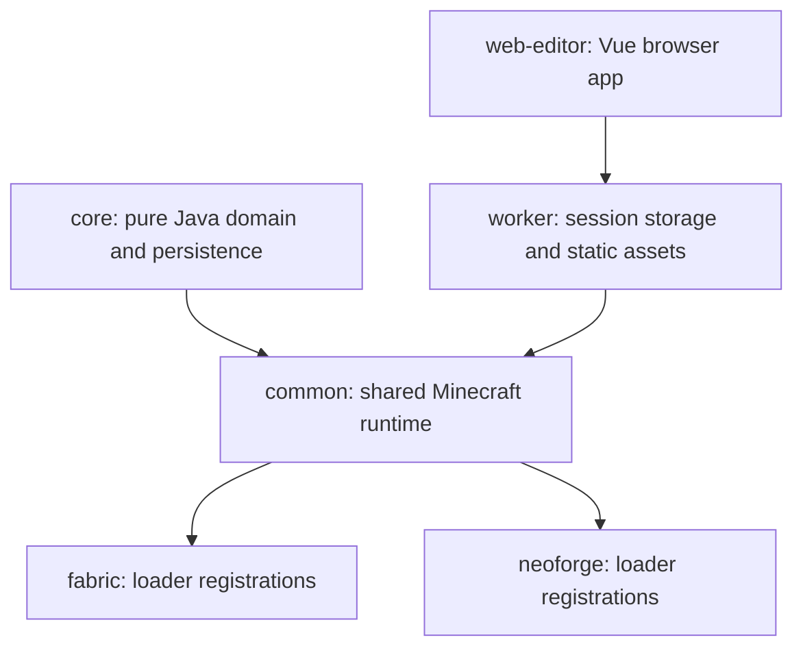

# Developer Architecture

UniCrates splits pure Java decision/configuration code from Minecraft execution and loader entrypoints. Most server content is data-driven; use [crate JSON](../custom-content/json), [model import](../custom-content/model-import), and [timelines](../custom-content/animations) before changing code.

## Modules and boundaries



| Module | Responsibilities |
| --- | --- |
| `core` | `java-library` module without Minecraft/Loom dependencies; config POJOs and validators, weighted selection and opening decisions, timeline/easing math, model/resource validators and pack assembly, player data/storage, HTTP editor client |
| `common` | Anchor/key behavior, registered canvases/components, inventory and reward delivery, display/timeline/scene runtime, permissions, soft-dependency integrations, transaction coordination, commands and network payloads |
| `fabric` | Fabric entrypoint, static registrations, networking/events, loader-specific platform implementation |
| `neoforge` | NeoForge entrypoint, static registrations, networking/events, loader-specific platform implementation |
| `web-editor` | Browser form state, Java geometry/textures and emitter previews, timeline editing, payload conversion and resource staging |
| `worker` | Cloudflare Worker session API, 24-hour KV storage, bounded JSON ingestion, browser asset hosting |

The pure core also contains JDBC dependencies and player-data persistence; storage is not exclusively in `common`. Minecraft mutations are coordinated by common runtime services.

## Platform services

`com.unicrates.platform.Services.PLATFORM` is a static delegate initialized through Java `ServiceLoader`. Each loader supplies a `META-INF/services/com.unicrates.platform.PlatformHelper` implementation. This checkout does not use Architectury API runtime `@ExpectPlatform` transforms.

The `PlatformHelper` interface includes loader checks, platform name, preview/spin/selectable/editor menus, reward bundle editing, cinematic camera control, scene start/stop delivery, and companion handshake traffic. Loader-specific implementations own those operations. There is no public `Services.setPlatform(...)` method; choose the actual service-file mechanism when adding a loader implementation.

## Useful core entry points

| Class | Source-level contract |
| --- | --- |
| `CrateConfig` / `RewardConfig` | Gson-backed domain models for crate and reward definitions |
| `CrateConfigValidator.validate(config, expectedId)` | Returns a list of semantic errors; empty means valid |
| `CrateOpenService.attemptOpen(...)` | Evaluates cooldowns, availability, permissions/limits and weighted selection; returns `OpenDecision` |
| `TimelineValidator.validate(timeline, expectedId)` | Validates the typed timeline |
| `AnimationLoader.validateSnapshot(...)` | Validates a timeline set including inheritance |
| `ModelAssetValidator.validateJson(json)` | Validates bounded Java cube-model JSON |
| `ModelAssetValidator.validatePng(bytes)` | Validates PNG dimensions, chunk integrity and decoding |
| `ResourceUploadValidator.validate(resources)` | Decodes and validates a complete upload patch |
| `ResourceUploadValidator.validateReferences(...)` | Resolves model/texture dependencies against preserved resources plus uploads |
| `ResourcePackAssembler.assemble(root, output, crates)` | Produces assets plus an `AssemblyReport` with counts/warnings |
| `ResourcePackAssembler.zipAndHash(directory)` | Produces a ZIP and Minecraft SHA-1 delivery information |

These are real source entry points, not a versioned, compatibility-guaranteed third-party SDK. Pin an integration to the UniCrates version you build against and check signatures during upgrades.

## Reward issuer contract

The real runtime interface is:

```java
package com.unicrates.reward;

import com.unicrates.core.crate.CrateConfig;
import com.unicrates.core.reward.RewardConfig;
import net.minecraft.server.level.ServerPlayer;

public interface RewardIssuer {
    boolean issue(ServerPlayer player, CrateConfig crate, RewardConfig reward);
    default boolean isAvailable() { return true; }
    // The source also exposes issueAsync overloads with PlayerData
    // and an explicit transactionId for durable delivery.
}
```

`RewardIssuers.get(RewardType)` looks up built-in issuers. `implementedTypes()` includes only registered issuers whose `isAvailable()` currently succeeds, which lets opening selection exclude unavailable integrations.

### Extending rewards in the source

There is no `RewardDispatcher`, `RewardContext`, or public issuer-registration method in this checkout. `RewardIssuers` owns a private `EnumMap`; `RewardType` is a closed enum. Adding a new reward kind is a source change:

1. Add the serialized ID to `RewardType` and any needed fields to `RewardConfig`.
2. Implement `RewardIssuer`, including an availability guard if an optional integration is required.
3. Add the issuer to the `RewardIssuers` initialization map.
4. Extend validation, display resolution, browser conversion/forms, and preview behavior where the new kind needs them.
5. Preserve the explicit transaction identity and durable recovery behavior for external or asynchronous rewards.

Example of a simple implementation body for a source extension:

```java
@Override
public boolean issue(ServerPlayer player, CrateConfig crate, RewardConfig reward) {
    if (reward.experienceAmount == null || reward.experienceAmount <= 0) {
        return false;
    }
    player.giveExperiencePoints(reward.experienceAmount);
    return true;
}
```

This uses an existing reward field to show the actual method signature. It does not register a new reward type. Complex issuers should override the real `issueAsync` contract rather than calling synchronous delivery that expects an awaited transaction.

## Transactions and threads

`PlayerTransactions.submit(server, playerUuid, operation)` serializes work through the player's transaction coordinator. `PlayerTransactions.main(server)` returns the authoritative executor for continuations that touch game state. `PlayerTransactions.save(uuid, data)` exposes the asynchronous persistence step.

Keep blocking file/database/network work off the tick thread. Await durable writes before advancing transaction state; resume inventory/entity/command mutations on the server executor. A successful future means the operation was awaited, not automatically that every external side effect is exactly-once.

Command rewards, Pokémon delivery, economy rewards, permission rewards, selectable reservations, and recovery have dedicated durable state. Use the existing pipeline; calling an issuer directly can bypass costs, reservations, pending state, and recovery checks. See [commands](../administration/commands) for administrator recovery operations.

## Registry, display, and client invariants

- Register blocks/items/components and bundled display variants at startup. A reload changes definitions and existing component/block-entity data; it does not add arbitrary new registry entries.
- Physical keys use the static key item. Imported crate meshes use the existing paper item plus `CUSTOM_MODEL_DATA`.
- Keep client-only menus/renderers and companion code isolated from dedicated-server initialization.
- Preserve display entity position when loading partial entity tags. Maintain base/lid pivots and Minecraft yaw/pitch conventions for hinges.
- Keep `appearance.idleYOffset` separate from `particles.heightOffset`; the former changes the model anchor and the latter changes only the emitter.
- Bound custom packet data, browser resources, timeline actions, file reads, and work scheduled per tick.

## Integration and maintenance

[Integrations](./integrations) documents Cobblemon, LuckPerms, Impactor, Discord, economy-provider registration, and the relay contract. Use [web editor](../custom-content/web-editor) for the exact public save/apply semantics and current authorization limits.

For source changes, run the relevant core tests and the loader build. Review dedicated-server loading, recovery paths, and in-game behavior when those systems change. A passing documentation build alone verifies neither a loader release nor Minecraft mechanics.
